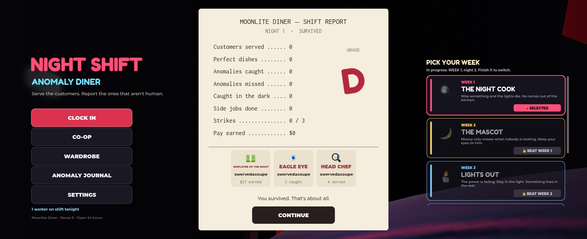
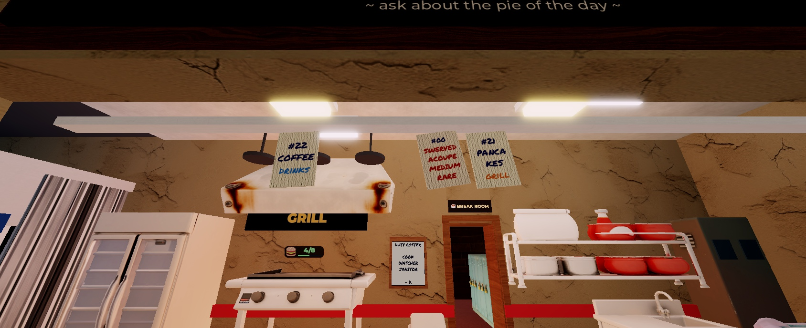
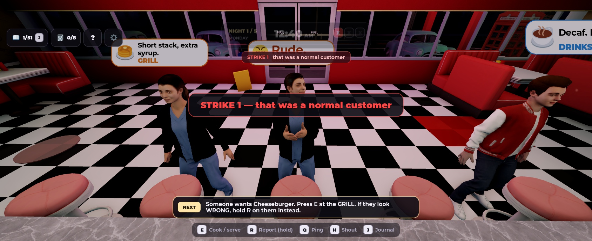
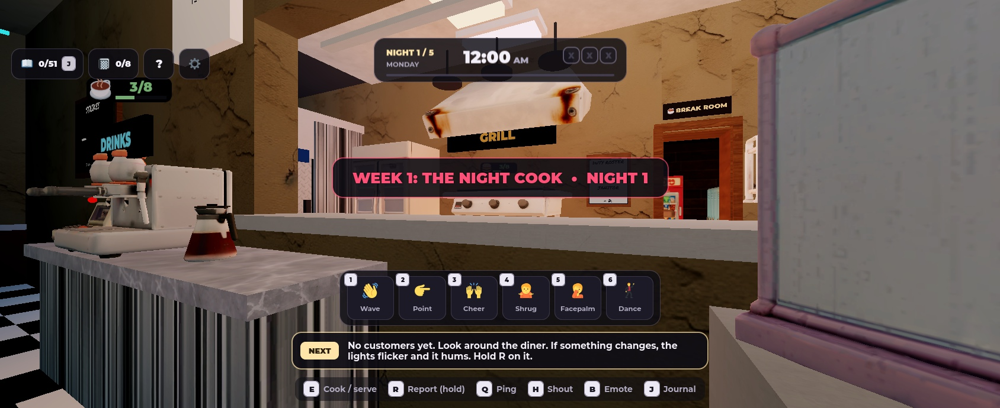
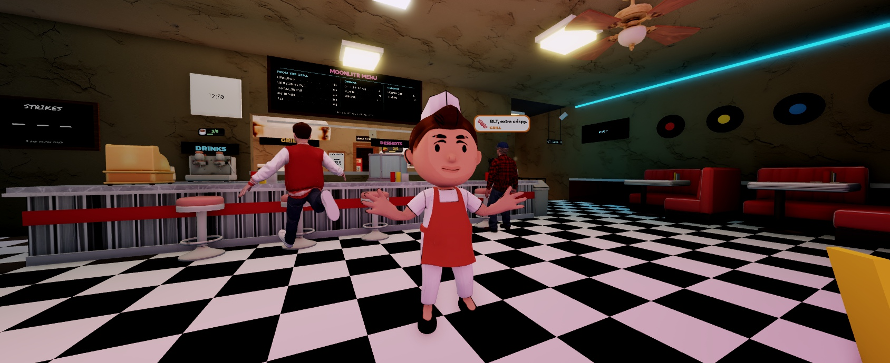

# Dev log

A dated record of what changed each day. The game lives in a Roblox place (the scripts are not in this repo), so this log and the screenshots are the public record of the work.

## 2026-11-09
- **Overnight polish pass (saved in the place, not published yet):**
  - **Goofy body language:** a procedural animation layer on top of the normal animations, for every player and customer.
    - Interactions get a reaction: poke, grab, shove a door, crank a breaker, scrub, dive into a hiding spot, tear a note and more.
    - Outcomes too: a bow on a serve, a chef's kiss on a perfect dish, a facepalm on a wrong report, a cough on a burnt grill, a fist pump on a catch.
    - Carrying poses (hugging a supply box, a careful waiter with a plate), tiptoeing and trembling during blackouts, idle fidgets, and the crew dances when a night is survived.
  - **Emotes:** press B, then 1–6, for wave, point, cheer, shrug, facepalm or dance.
  - **Customers with moods:** they cross their arms and tap a foot when impatient, cheer when served, and huff off ("Rude.") when wrongly reported. Normal customers make small talk.
  - **New anomalies:** The Twist (legs on backwards, moonwalks in), The Copycat (a copy of one of your crew), The Trail (wet red footprints from the door), and Order Up (a ticket on the rail for one of the crew, "medium rare").
  - **Order tickets:** each order hangs on a ticket rail in the kitchen and is stamped PAID, VOID or WALKED when the customer leaves.
  - **Reported anomalies** dissolve into black smoke with a sucked-in whoosh.
  - **Shift report:** prints like a receipt line by line, a grade stamp slams down, and crew awards show who did what (Employee of the Night, Eagle Eye, Head Chef, Lifesaver, Broom Menace, Snack Time).
- Tested in Roblox Studio. Not everything was checked by eye: the PAID/VOID/WALKED drop animation and the longer smoke were not screenshotted.

## 2026-11-08
- **UI pass (saved in the place, not published yet):**
  - **Shared design system:** a `UIKit` module (colours, fonts, key labels, hover effects, tooltips) used across the HUD.
  - **HUD:**
    - New status bar: night, weekday, clock, strike boxes, shift progress.
    - Messages show as a centred card and queue up.
    - The last strike's reason stays on screen for 12 s.
    - The key-hint row only lists keys that work this week.
    - One button row at the top left: journal, notebook, role, help, settings.
  - **Custom prompt cards:** a key label, a hold-progress fill and a red style for Report. Click or tap to hold also works.
  - **Order bubbles:** they shrink and sit lower when you are at the counter, and the clock bar fades if a bubble is behind it.
  - **Tutorial:** rebuilt as a 7-page card with progress dots and Back/Next (keyboard works too).
  - **Journal:** filter tabs with counts and a progress bar. Caught pages are listed first, and it no longer sits under the HUD.
  - **Settings:** grouped sections and switches, plus a new Objective hints option (Auto / On / Off).
  - **Cooking stations:** dishes customers are waiting on are highlighted with a count, and the panel fits its contents. The pour button no longer covers the hint text.
- **Polish pass:**
  - **Week 5:** fake notes are written in pencil on paler paper, and the tape and cork board hint at it.
  - **Week 5:** Mr. Grey looks visibly worse after each wrong dish.
  - **Week 3:** a 25 s grace period at the start of each night, so idle players aren't grabbed during the intro tape.
  - **Week 4:** the rule notes show their first words when you aim at them.
  - **Clock-in card:** shows the week's goal first.
  - **Regression run:** Week 1 night 1, Week 2 night 3, Weeks 3–5 including the night-5 finales. The console is clean apart from the expected Studio DataStore notice.
- **Known issue:** before a Week 4 shift starts, the rules board shows placeholder text.

## 2026-11-06
- **Week 2 (Moony) redesign:**
  - A "restlessness" meter replaces the old always-watch rule. It fills while nobody looks at him and escalates through turning, a scary face, creaks, moving closer, then a hunt.
  - Scheduled hunts, synced blinks and staring fatigue.
  - Footprints, and a shared Polaroid camera whose flash freezes him.
- **Week 3 "Lights Out" playable:**
  - Diner lighting zones, scheduled outages, and a generator you refuel with carried fuel.
  - Lanterns you carry and place, and a darkness "exposure" meter that grabs players who stay in the dark.
  - A night-5 finale.
- **Week 4 "The Night Manager" playable:**
  - A tall faceless figure walks rounds and checks nine house rules.
  - Some rules on the board are fakes; tear the right one down for a bonus.
  - Surprise inspections, and a night-5 finale.
- **Week 5 "The Regular" playable:**
  - A regular orders "the usual". Clue notes, some of them lies, hide around the diner.
  - Each wrong dish makes him worse; three and he stands up.
- **Shared systems:**
  - Shift lighting acts (colour by hour, dawn birds and bell).
  - A chalk tally board for strikes.
  - Context pings (Q) on customers, props and stations.
  - The break cinematic now plays once per break.
- **Fixes:**
  - Moony could never follow players into the kitchen: his pathfinding height was taller than the doorway.
  - The Union Rep upgrade's fourth strike now works.
  - Leaderstats now appear for players who joined early.
- A checkpoint build was published to Roblox that night.

## 2026-11-04 – 11-05
- Wrote design plans for Week 2 (Moony), Week 3 (Lights Out) and Weeks 4–9, plus a core gameplay and immersion improvement plan with prioritised quick wins.

## 2026-11-03
- **Base game fixes and content:**
  - The front door bar no longer gets stuck.
  - Bad-food streak protection, so you don't get several bad dishes in a row.
  - Food anomalies are clearer.
  - Order icons on customer bubbles.
  - Walt no longer walks through walls (door pathfinding modifiers).
  - The basement stairs are fixed.
- **New customer anomalies:** headless, puppet, black tears, spinning head, glitch, two heads, and others. The existing ones are stronger.
- **Getting caught:** a scream-face close-up and a ragdoll.
- **Cameras:** Walt is seen crossing the parking lot before a blackout, and a radio can lure him away.
- **Hiding spots:** dumpster, phone booth and coal bin.
- **Break room and co-op:**
  - The crew sits down together to pause, with an "assembled" cinematic and custom sitting poses.
  - A shared Crew Fund and a vote-and-raffle for team upgrades, on a cork-board plan screen.
  - Coffee slows the minigame bars down.
  - A secret broom.
- **Weeks as levels:**
  - The week list, a hunter proxy, trophies and the week picker.
  - Week 2 (Moony) built, including the Blender model, the watched check and a sanity meter.
- Moony and an extra-arm anomaly were modelled in Blender.

## 2026-11-02
- Wrote the game design document.
- The core game was already in place by then:
  - Customers and orders, three cooking minigames, anomalies and reporting.
  - Walt and the blackouts, five nights, and story tapes.
  - The journal, the notebook ending, wardrobe cosmetics and the co-op lobby.
