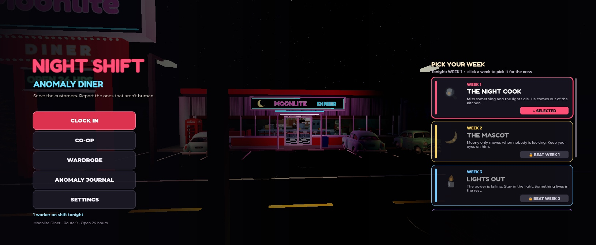
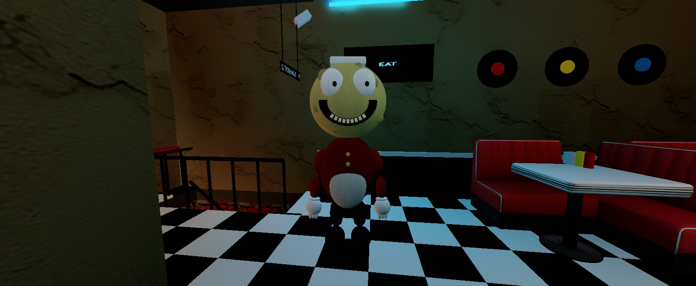
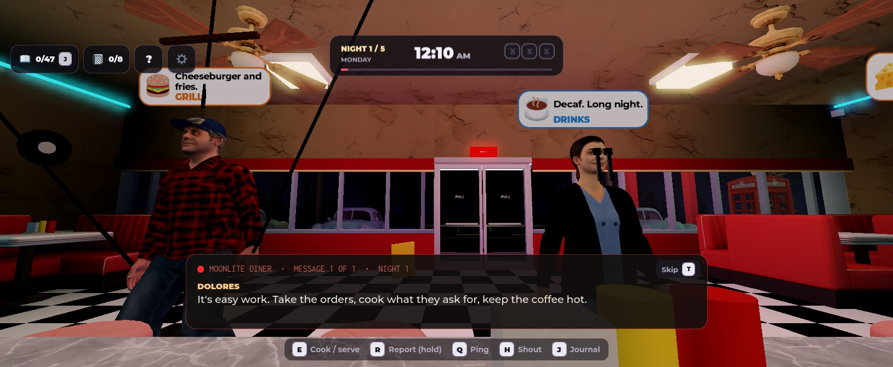
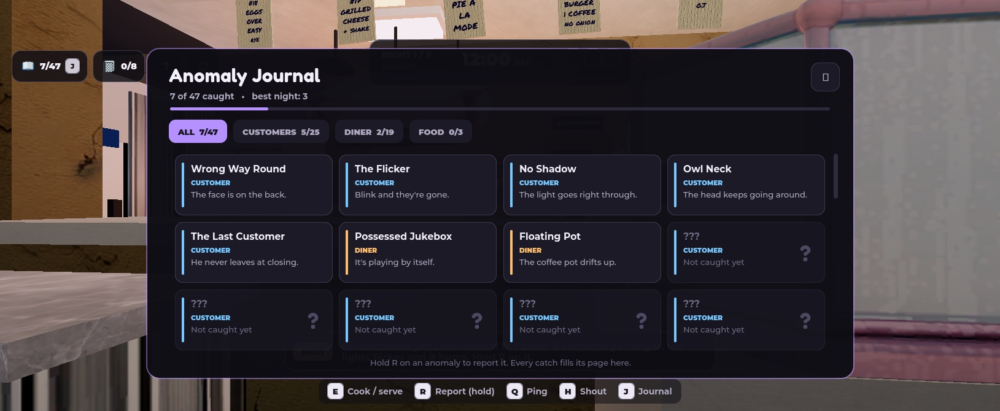
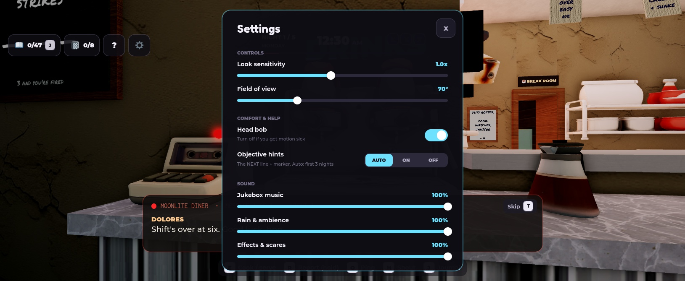
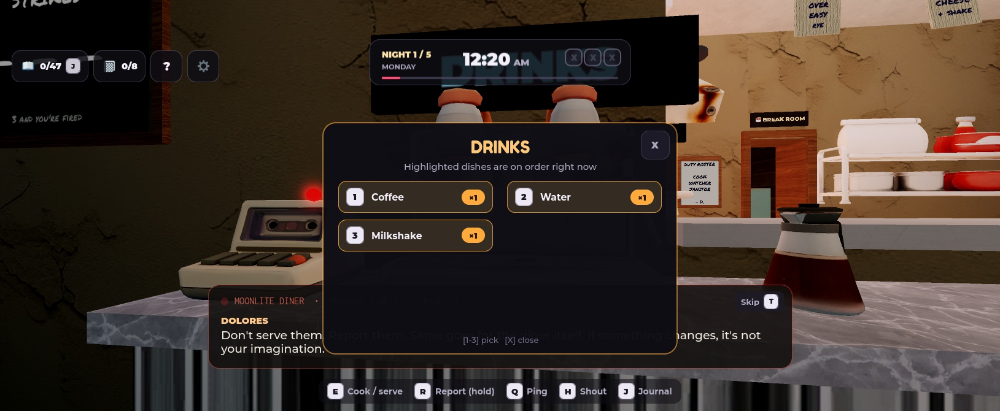
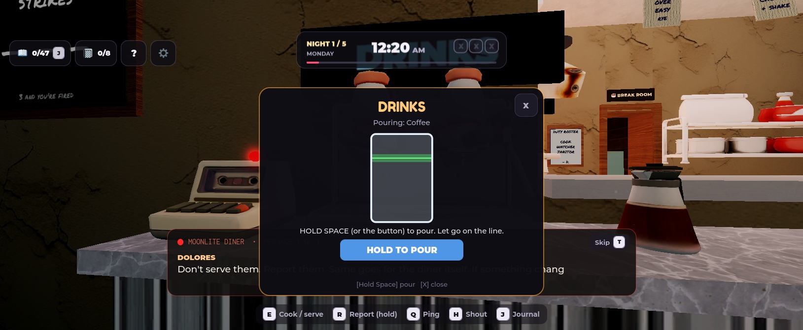

# Night Shift: Anomaly Diner

A co-op horror game on Roblox (Luau). You and your friends work the night shift at the Moonlite Diner on Route 9. You take orders, cook and serve, and spot the customers (and objects, and food) that aren't quite right. Report them with **R**. Miss one and something worse comes out.

Each **week** is its own level with its own hunter, rules and finale, and five nights from Monday to Friday. Beating a week earns a trophy and unlocks the next one.

## Progress

| Week | Hunter | Core idea | Status |
|---|---|---|---|
| 1 | **Walt, the Night Cook** | Miss an anomaly and the lights die. Hide until the power is back. | Playable |
| 2 | **Moony, the Mascot** | He only moves when nobody is looking. Watch him on cameras; a Polaroid flash freezes him. | Playable |
| 3 | **Lights Out** | The power is failing. Stay in the light, carry lanterns, refuel the generator. | Playable |
| 4 | **The Night Manager** | House rules on a board; some are fakes. Break a real rule while he is watching and you get written up. | Playable |
| 5 | **The Regular** | Mr. Grey orders "the usual" but never says what it is. Find Dolores' notes; some of them lie. | Playable |
| 6–9 | Freezer Thing, Inspector, Delivery Driver, Closing Time (finale) | | Designed, not built |

Shared systems:
- 47 anomalies to catch: customer, diner and food anomalies.
- Three cooking minigames: grill, pour and slice.
- Station stock, with supply runs to the basement.
- Six security cameras.
- A break room where the crew pools money, votes on team upgrades and pauses together.
- Cassette tapes that tell the story, a notebook with a hidden ending, and a wardrobe of cosmetics.
- Strikes (three and you're fired).

## Interface

The interface uses one shared set of colours, fonts and key labels.

The HUD shows:
- A status bar with the night, weekday, clock, strike boxes and shift progress.
- A row of key hints that changes with the week.
- Custom "hold E" prompt cards.

Order bubbles shrink and lower when you stand at the counter.

| | |
|---|---|
|  |  |
|  |  |

## How it is built

The game lives in a Roblox place, so this repo holds the write-up, not the scripts.

- **Server**
  - `ShiftManager`: the night loop, customers, anomalies, strikes and rewards.
  - `Kitchen`: stock, cooking results and bad food.
  - A hunter module per week: `Entity`, `Moony`, `Dark`, `Manager`, `Regular`.
  - `Hunters` proxy: forwards to the current week's hunter, so the shift loop never needs to know which one is active.
  - Services for doors, cameras, hiding, the break room, the notebook, saves (DataStore) and co-op lobbies (MemoryStore + reserved servers).
- **Client**
  - One LocalScript per UI area: HUD, kitchen, journal, cameras, the break-room plan board, the per-week effects, and others.
  - A shared `UIKit` module for the design system.
- **Assets**
  - Moony and some props are modelled in Blender from Python scripts, then exported as FBX and imported into Studio.
  - The table poses are custom animations.
  - Audio is licensed library audio only.

See [DEVLOG.md](DEVLOG.md) for a dated record of the work.
